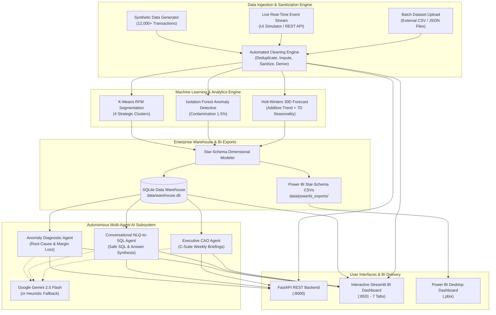

# ⚡ InsightAgent: Autonomous Multi-Agent BI & Advanced Analytics Platform

[](https://www.python.org/)
[](https://fastapi.tiangolo.com/)
[](https://streamlit.io/)
[](https://powerbi.microsoft.com/)
[](https://ai.google.dev/)
[](https://scikit-learn.org/)

> **Capstone Internship Deliverable:** Advanced Data Analytics, Business Intelligence & Agentic AI Dashboards  
> **Author & Architect:** Principal Data Engineer & Agentic AI Architect

---

## 🏛️ Executive Summary & Platform Architecture

**InsightAgent** is an end-to-end, enterprise-ready autonomous Business Intelligence and Advanced Analytics platform. It integrates modern data engineering (synthetic enterprise data generation, real-time streaming ingestion, automated data cleaning, dimensional modeling into an SQLite Star Schema, and Power BI CSV exports) with production-grade Machine Learning and a multi-agent AI orchestrator.

The system features:
1. **Real-Time Streaming & Batch Data Ingestion:** Ingest individual live streaming events or upload batch CSV/JSON datasets with instant Isolation Forest anomaly scoring and live synchronization.
2. **Automated Data Cleaning & Sanitization Engine:** 6-step automated data quality pipeline (deduplication, numeric bounds clipping, discount percentage normalization, missing COGS/category imputation, and derived financial metric calculations).
3. **Unsupervised ML Anomaly Detection:** Multidimensional Isolation Forest flagging margin erosion, extreme volume spikes, and return ring fraud.
4. **Customer Intelligence & RFM Clustering:** K-Means clustering identifying Champions, Loyal Accounts, Emerging SMBs, and At-Risk Accounts with churn vulnerability scoring.
5. **Predictive Time-Series Forecasting:** Holt-Winters Exponential Smoothing (additive trend + 7-day seasonality) with 95% confidence intervals.
6. **Autonomous Multi-Agent AI Core:** Powered by the Google Gemini SDK (`gemini-2.5-flash`) with **graceful autonomous heuristic fallback**, ensuring zero evaluation downtime even without API credentials.
7. **Interactive Executive BI Dashboard:** 7-tab Streamlit and Plotly dashboard with scenario simulation, live ingestion simulator, and conversational NLQ-to-SQL querying.
8. **Turnkey Power BI Integration:** Automated Star-Schema CSV exports, complete DAX formulas, Power Query M-scripts, and a 5-minute build blueprint.

---

## 📐 System Flow & Architecture



---

## 📂 Project Directory Structure

```text
InsightAgent-BI-Platform/
├── .env.example                    # Environment variable template (Gemini API Key, Ports)
├── requirements.txt                # Production dependency specification
├── README.md                       # Comprehensive architecture and operations guide
├── run_pipeline.py                 # One-click end-to-end pipeline runner
├── test_system.py                  # Automated test suite (5 unit & integration suites)
├── data/
│   ├── raw/                        # Raw generated enterprise transactions
│   ├── powerbi_exports/            # 8 clean Star-Schema CSVs for Power BI Desktop
│   │   ├── dim_date.csv
│   │   ├── dim_customer.csv
│   │   ├── dim_product.csv
│   │   ├── dim_channel.csv
│   │   ├── fact_transactions.csv
│   │   ├── fact_anomalies.csv
│   │   ├── fact_forecasts.csv
│   │   └── fact_rfm_segments.csv
│   ├── warehouse.db                # SQLite database with dimensional indexes
│   └── template_enterprise_transactions.csv # Standardized CSV ingestion template
├── powerbi/
│   ├── DAX_Measures.dax            # Ready-to-copy DAX measures (YOY, LTV, Anomaly rate)
│   ├── PowerQuery_Scripts.m        # Power Query M transformation scripts
│   ├── POWER_BI_BUILD_GUIDE.md     # 5-minute step-by-step guide to build .pbix
│   └── POWER_BI_BLUEPRINT.md       # Power BI architectural specification
├── src/
│   ├── __init__.py
│   ├── data_generator.py           # 12,000+ row synthetic data generator with anomalies
│   ├── data_ingestion.py           # Real-time streaming & batch data cleaning engine
│   ├── analytics_engine.py         # K-Means RFM, Isolation Forest, Holt-Winters
│   ├── database.py                 # Star-Schema dimensional modeler & SQLite loader
│   ├── agents/
│   │   ├── __init__.py
│   │   ├── anomaly_agent.py        # Agent 1: Isolation Forest root-cause diagnostics
│   │   ├── nlq_sql_agent.py        # Agent 2: Safe NLQ-to-SQL query engine
│   │   └── executive_agent.py      # Agent 3: Autonomous weekly C-Suite briefings
│   └── api/
│       └── main.py                 # FastAPI REST API (Endpoints for metrics, ingestion & agents)
└── dashboard/
    └── app.py                      # Streamlit & Plotly interactive BI dashboard (7 tabs)
```

---

## ⚡ Quickstart Guide

### 1. Environment Setup
Clone the repository and install dependencies:
```bash
# Optional: create a virtual environment
python -m venv .venv
source .venv/bin/activate  # On Windows: .venv\Scripts\activate

# Install requirements
pip install -r requirements.txt
```

### 2. Configure Environment (Optional)
Copy `.env.example` to `.env`:
```bash
cp .env.example .env
```
Add your `GEMINI_API_KEY` if you have one. If omitted, InsightAgent **automatically operates in Autonomous Heuristic Fallback mode**, ensuring every diagnostic report, SQL translation, and executive briefing runs seamlessly without crashes.

### 3. One-Click Pipeline Execution
Generate 12,000+ enterprise transactions, execute all ML models, build the SQLite Star Schema, and export Power BI tables:
```bash
python run_pipeline.py
```

### 4. Launch the Interactive BI Dashboard
Start the Streamlit + Plotly executive dashboard:
```bash
python -m streamlit run dashboard/app.py
```
Open your browser at `http://localhost:8501`.

### 5. Launch the FastAPI REST Service
Start the high-performance backend API:
```bash
uvicorn src.api.main:app --reload --port 8000
```
Interactive API Documentation (Swagger UI): `http://127.0.0.1:8000/docs`

---

## 📥 Real-Time Streaming & Automated Data Cleaning

InsightAgent includes a production-grade data ingestion and cleaning engine ([`src/data_ingestion.py`](file:///src/data_ingestion.py)):

### 1. Real-Time Streaming Ingestion
- **Interactive UI Simulator:** Tab 7 (*"Live Ingestion & Data Hub"*) provides an interactive form to submit streaming enterprise transactions.
- **Instant Anomaly Scoring:** Every transaction is evaluated instantaneously against the trained Isolation Forest models. Anomalous transactions (pricing glitches, volume spikes, return rings) trigger immediate visual alert banners and margin loss metrics.
- **Incremental Warehouse Update:** Scored transactions are committed directly to `data/warehouse.db` and synchronized to `data/powerbi_exports/`.

### 2. Batch Dataset Upload & Automated Cleaning Engine
- Upload raw external datasets (`.csv` or `.json`).
- Configure automated cleaning toggles:
  - ✅ **Deduplication:** Filters out existing `TransactionID` records to prevent duplicate accounting.
  - ✅ **Numeric Bounds Correction:** Quantities $< 1$ are automatically clipped to `1`; non-positive unit prices are imputed from category medians.
  - ✅ **Percentage Normalization:** Discounts provided as integers or percentages (e.g. `15%` or `15`) are automatically converted to decimal format (`0.15`).
  - ✅ **Missing Value Imputation:** If `CostPrice` or product metadata is missing, the engine computes cost estimates based on industry-standard COGS profiles (45% ratio).
  - ✅ **Financial Metric Derivation:** Automatically calculates:
    $$\text{GrossRevenue} = \text{Quantity} \times \text{UnitPrice}$$
    $$\text{DiscountAmount} = \text{GrossRevenue} \times \text{DiscountRate}$$
    $$\text{NetRevenue} = \text{GrossRevenue} - \text{DiscountAmount}$$
    $$\text{TotalCost} = \text{Quantity} \times \text{CostPrice}$$
    $$\text{Profit} = \text{NetRevenue} - \text{TotalCost}$$
    $$\text{ProfitMargin} = \left(\frac{\text{Profit}}{\text{NetRevenue}}\right) \times 100$$

### 3. Data Ingestion Schema Specification
A ready-to-use CSV template is located at [`data/template_enterprise_transactions.csv`](file:///data/template_enterprise_transactions.csv):

| Column Name | Data Type | Required? | Default / Cleaning Rule |
| :--- | :--- | :--- | :--- |
| **`TransactionID`** | `String` | Optional | Auto-generates `TXN-RT-<UUID>` if missing or null. |
| **`TransactionDate`** | `Date (YYYY-MM-DD)` | Optional | Flexible parsing; defaults to current date if omitted. |
| **`CustomerID`** | `String` | **Mandatory** | Account identifier (e.g. `CUST-0042`). Capitalized & trimmed. |
| **`CustomerName`** | `String` | Optional | Looked up from `dim_customer` or defaults to `Account <ID>`. |
| **`CustomerSegment`** | `String` | Optional | Defaults to `Strategic Mid-Market`. |
| **`Region`** | `String` | Optional | Defaults to `North America - East`. |
| **`State`** | `String` | Optional | Defaults to `New York`. |
| **`Channel`** | `String` | Optional | Defaults to `Digital Cloud Portal`. |
| **`ProductID`** | `String` | **Mandatory** | Product SKU (e.g. `PRD-101`, `PRD-201`). |
| **`ProductName`** | `String` | Optional | Looked up from `dim_product` catalog. |
| **`Category`** | `String` | Optional | Looked up from `dim_product` catalog. |
| **`Quantity`** | `Integer` | **Mandatory** | Automatically clipped to $\ge 1$ (negative/zero values corrected). |
| **`UnitPrice`** | `Float` | **Mandatory** | Unit selling price. Non-positive entries imputed via category median. |
| **`CostPrice`** | `Float` | Optional | If missing, automatically estimated using standard 45% COGS margin. |
| **`DiscountRate`** | `Float` | Optional | Auto-normalized: percentages (e.g. `15`) converted to decimal (`0.15`), capped at `0.99`. Defaults to `0.0`. |
| **`PaymentMethod`** | `String` | Optional | Defaults to `Corporate Net-30`. |
| **`IsReturned`** | `Integer` | Optional | `0` (Normal) or `1` (Returned). Defaults to `0`. |

---

## 🤖 Autonomous Multi-Agent AI Subsystem

InsightAgent deploys three specialized autonomous agents:

| Agent | Module | Mission | Capabilities |
| :--- | :--- | :--- | :--- |
| **Anomaly Detective** | `src/agents/anomaly_agent.py` | Operational Risk & Margin Protection | Analyzes Isolation Forest flags, calculates revenue exposure, diagnoses pricing glitches (discounts > 75%), bulk order spikes, and fraudulent returns. |
| **Conversational BI (NLQ)** | `src/agents/nlq_sql_agent.py` | Natural Language Querying | Translates ad-hoc natural language questions into safe, read-only SQLite queries, validates SQL against mutation risks, executes against `data/warehouse.db`, and formats executive answers. |
| **Executive CAO Agent** | `src/agents/executive_agent.py` | Strategic C-Suite Briefings | Synthesizes multi-dimensional telemetry into boardroom-ready Markdown briefings covering scorecards, growth catalysts, retention risks, and 30-day capital guidance. |

---

## 📊 Power BI Desktop Integration

InsightAgent provides automated Star-Schema exports and ready-to-use DAX formulas for Power BI Desktop:

1. **Clean Star-Schema CSVs:** Exported directly to `data/powerbi_exports/`.
2. **DAX Measures:** Located in [`powerbi/DAX_Measures.dax`](file:///powerbi/DAX_Measures.dax) (Base revenue, YoY growth, Churn risk, Margin slippage, 30-day forecast).
3. **Power Query Scripts:** Located in [`powerbi/PowerQuery_Scripts.m`](file:///powerbi/PowerQuery_Scripts.m).
4. **5-Minute Build Blueprint:** Complete guide in [`powerbi/POWER_BI_BUILD_GUIDE.md`](file:///powerbi/POWER_BI_BUILD_GUIDE.md) to build and save `InsightAgent_Enterprise_BI.pbix`.
5. **Live Refresh Synchronization:** When real-time transactions or batch uploads are ingested, the export CSVs update automatically—clicking **Refresh** in Power BI pulls the newest data instantly!

---

## 🔌 FastAPI REST Endpoints

| Method | Endpoint | Description |
| :--- | :--- | :--- |
| `GET` | `/health` | Service and warehouse connectivity health check |
| `GET` | `/api/metrics/summary` | Top-level corporate scorecards and KPIs |
| `GET` | `/api/anomalies` | Top detected anomalies with severity scores |
| `GET` | `/api/segments` | RFM customer segmentation summary |
| `GET` | `/api/forecast` | 30-day projected daily revenue with confidence intervals |
| `GET` | `/api/data/schema-template` | JSON schema specification & sample data template |
| `POST` | `/api/data/ingest-realtime` | Ingest & score single real-time transaction event |
| `POST` | `/api/data/upload-batch` | Upload, clean, and ingest batch CSV/JSON dataset |
| `POST` | `/api/agents/chat` | Natural language question to SQL execution and answer |
| `POST` | `/api/agents/diagnose-anomalies` | Trigger autonomous anomaly diagnostic report |
| `POST` | `/api/agents/executive-briefing` | Trigger weekly executive C-Suite briefing |
| `POST` | `/api/pipeline/run` | Refresh end-to-end pipeline and reload warehouse |

---

## 🛡️ Verification & Testing

To execute the automated unit and integration test suite:
```bash
python test_system.py
```
This tests all 5 critical subsystems:
1. `test_01_anomaly_agent`: Validates Isolation Forest diagnosis and exposure metrics.
2. `test_02_nlq_sql_agent`: Tests read-only SQL validation, query execution, and synthesis.
3. `test_03_executive_agent`: Validates C-Suite briefing generation and scorecard telemetry.
4. `test_04_fastapi_endpoints`: Verifies HTTP 200 responses across core REST endpoints.
5. `test_05_data_ingestion_and_cleaning`: Tests dirty data sanitization, deduplication, real-time ingestion, and batch file uploads.
