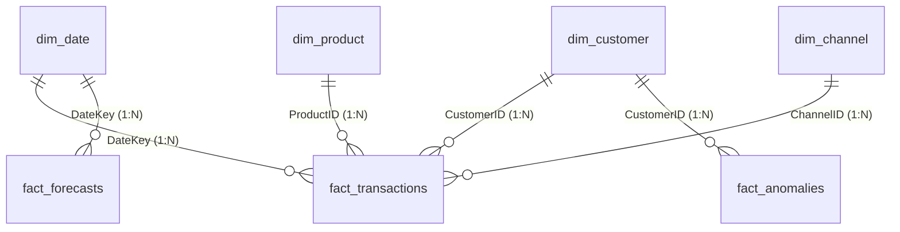

# 📊 InsightAgent Power BI Enterprise Dashboard: 5-Minute Build Guide

Welcome to the **InsightAgent Power BI Desktop Build Blueprint**. This guide enables you to build and save a production-grade enterprise dashboard (`InsightAgent_Enterprise_BI.pbix`) in under 5 minutes using the automated Star-Schema CSV exports and DAX measures generated by the pipeline.

---

## 🏛️ 1. Star-Schema Data Model Overview

The analytics pipeline pre-processes and normalizes 12,000+ enterprise transactions into a clean Star Schema:

### Table Dictionary
| Table Name | Type | Purpose | Primary / Foreign Keys |
| :--- | :--- | :--- | :--- |
| **`dim_date`** | Dimension | Continuous calendar dimension with Year, Quarter, Month, Day, DayOfWeek | `DateKey` (PK) |
| **`dim_customer`** | Dimension | Customer accounts with K-Means RFM Segments, Churn Risk, and Lifetime Spend | `CustomerID` (PK) |
| **`dim_product`** | Dimension | Product catalog with category taxonomy, base prices, and margins | `ProductID` (PK) |
| **`dim_channel`** | Dimension | Sales channels (Direct Sales, Digital Portal, Resellers) | `ChannelID` (PK) |
| **`fact_transactions`** | Fact | 12,000+ core transactions with revenue, cost, profit, discount, anomaly flags | `TransactionID` (PK), `DateKey`, `CustomerID`, `ProductID`, `ChannelID` |
| **`fact_anomalies`** | Fact | Isolated high-severity anomalies with root-cause tags & severity scores | `TransactionID`, `DateKey`, `CustomerID` |
| **`fact_forecasts`** | Fact | 30-day ahead forecasted revenue with 95% confidence intervals | `DateKey` |
| **`fact_rfm_segments`** | Aggregated | High-level summary of customer counts and revenue shares per cluster | `RFM_Segment` |

---

## 🚀 2. Step-by-Step 5-Minute Build Instructions

### Step 1: Ingest Data via Power Query (60 Seconds)
1. Open **Power BI Desktop**.
2. Click **Get Data** -> **Folder** (or **Text/CSV**).
3. Select the folder path:
   `c:\Users\Admin\Documents\code\E-G-InsightAgent\data\powerbi_exports\`
4. Alternatively, click **Home -> Transform Data**, open the **Advanced Editor**, and paste the scripts from [`powerbi/PowerQuery_Scripts.m`](file:///c:/Users/Admin/Documents/code/E-G-InsightAgent/powerbi/PowerQuery_Scripts.m).
5. Click **Close & Apply**.

---

### Step 2: Establish Model Relationships (45 Seconds)
Navigate to the **Model View** (left navigation bar) and verify/create the following **1-to-Many (`1:*`) Single Direction** relationships:

1. `dim_date[DateKey]` $\rightarrow$ `fact_transactions[DateKey]`
2. `dim_customer[CustomerID]` $\rightarrow$ `fact_transactions[CustomerID]`
3. `dim_product[ProductID]` $\rightarrow$ `fact_transactions[ProductID]`
4. `dim_channel[ChannelID]` $\rightarrow$ `fact_transactions[ChannelID]`
5. `dim_date[DateKey]` $\rightarrow$ `fact_forecasts[DateKey]` *(Active or Inactive)*
6. `dim_customer[CustomerID]` $\rightarrow$ `fact_anomalies[CustomerID]`

---

### Step 3: Create DAX Measures Table (60 Seconds)
1. In the **Home** tab, click **Enter Data**.
2. Name the table `_DAX_Measures` and click **Load**.
3. Open [`powerbi/DAX_Measures.dax`](file:///c:/Users/Admin/Documents/code/E-G-InsightAgent/powerbi/DAX_Measures.dax).
4. Right-click `_DAX_Measures` in the Fields pane $\rightarrow$ **New Measure**, and paste the core measures:
   - `Total Net Revenue`
   - `Total Operating Profit`
   - `Gross Profit Margin %`
   - `Average Order Value (AOV)`
   - `Total Anomalies Flagged`
   - `Anomaly Revenue Exposure`
   - `Anomaly Direct Loss / Margin Erosion`
   - `Champions Revenue Share %`
   - `Forecasted Revenue 30D`

---

### Step 4: Build the 4 Report Pages (2 Minutes)

#### Page 1: 🏛️ Executive KPI Boardroom Overview
- **Header:** Title "InsightAgent Executive Scorecard", slicer for `dim_date[Year]` and `dim_date[MonthName]`.
- **Top KPI Cards:**
  - Card 1: `[Total Net Revenue]` (Format: Currency `$#,##0`)
  - Card 2: `[Total Operating Profit]` (Format: Currency `$#,##0`)
  - Card 3: `[Gross Profit Margin %]` (Format: Percentage `0.0%`)
  - Card 4: `[Average Order Value (AOV)]`
- **Visual 1 (Area / Line Chart):** `dim_date[FullDate]` on X-axis, `[Total Net Revenue]` on Y-axis.
- **Visual 2 (Clustered Bar Chart):** `dim_product[Category]` on Y-axis, `[Total Net Revenue]` and `[Total Operating Profit]` on X-axis.
- **Visual 3 (Donut Chart):** `dim_channel[ChannelName]` by `[Total Net Revenue]`.

#### Page 2: 🚨 Autonomous Anomaly Detective
- **Top KPI Cards:**
  - Card 1: `[Total Anomalies Flagged]` (Callout value in Red)
  - Card 2: `[Anomaly Revenue Exposure]`
  - Card 3: `[Anomaly Direct Loss / Margin Erosion]`
- **Visual 1 (Scatter Plot):**
  - X-Axis: `fact_transactions[DiscountRate]`
  - Y-Axis: `fact_transactions[ProfitMargin]`
  - Legend: `fact_transactions[Detected_Anomaly_Type]`
  - Tooltips: `TransactionID`, `CustomerName`, `NetRevenue`
- **Visual 2 (Table / Matrix):**
  - Columns: `TransactionID`, `TransactionDate`, `CustomerName`, `ProductName`, `Quantity`, `DiscountRate`, `Profit`, `Anomaly_Score`, `Detected_Anomaly_Type`.
  - Conditional Formatting: Background color on `Anomaly_Score` (Red scale).

#### Page 3: 👥 Customer RFM Segmentation & Churn Risk
- **Top KPI Cards:**
  - Card 1: `[Active Customers Count]`
  - Card 2: `[Champions Revenue Share %]`
  - Card 3: `[At-Risk Accounts Count]`
- **Visual 1 (Clustered Column Chart):**
  - X-Axis: `dim_customer[RFM_Segment]`
  - Y-Axis: `[Total Net Revenue]` and `[Active Customers Count]`
- **Visual 2 (Tree Map):**
  - Group: `dim_customer[ChurnRisk]`
  - Values: `[Total Net Revenue]`
- **Visual 3 (Table):**
  - Filtered to `ChurnRisk IN {"Critical High Risk", "Medium At-Risk"}`.
  - Columns: `CustomerName`, `Region`, `Recency (Days)`, `Frequency`, `Monetary Spend`, `ChurnRisk`.

#### Page 4: 🔮 Predictive 30-Day Revenue Forecasting
- **Top KPI Cards:**
  - Card 1: `[Forecasted Revenue 30D]`
  - Card 2: `[Forecast Lower Bound 95%]`
  - Card 3: `[Forecast Upper Bound 95%]`
- **Visual 1 (Line & Confidence Ribbon Chart):**
  - X-Axis: `fact_forecasts[ForecastDate]`
  - Values: `ForecastedRevenue`, `LowerBound`, `UpperBound`
  - Legend / Details: `ModelType`

---

### Step 5: Save & Publish
1. Click **File -> Save As**.
2. Save to the project folder as `powerbi/InsightAgent_Enterprise_BI.pbix`.
3. Done! Your enterprise Power BI dashboard is completely operational.

---

## 🔄 3. Real-Time Ingestion & Live Power BI Refresh

InsightAgent features automated Star-Schema synchronization:
- Whenever new transactions enter via **Real-Time Streaming** (`POST /api/data/ingest-realtime`) or **Batch Upload** (`POST /api/data/upload-batch` or Streamlit Tab 7), the CSV exports in `data/powerbi_exports/` are updated automatically.
- To reflect newly ingested transactions in Power BI Desktop, simply click the **"Refresh"** button on the Home ribbon.
- All visuals, DAX measures, and anomaly flags will update immediately without altering the underlying data model!
